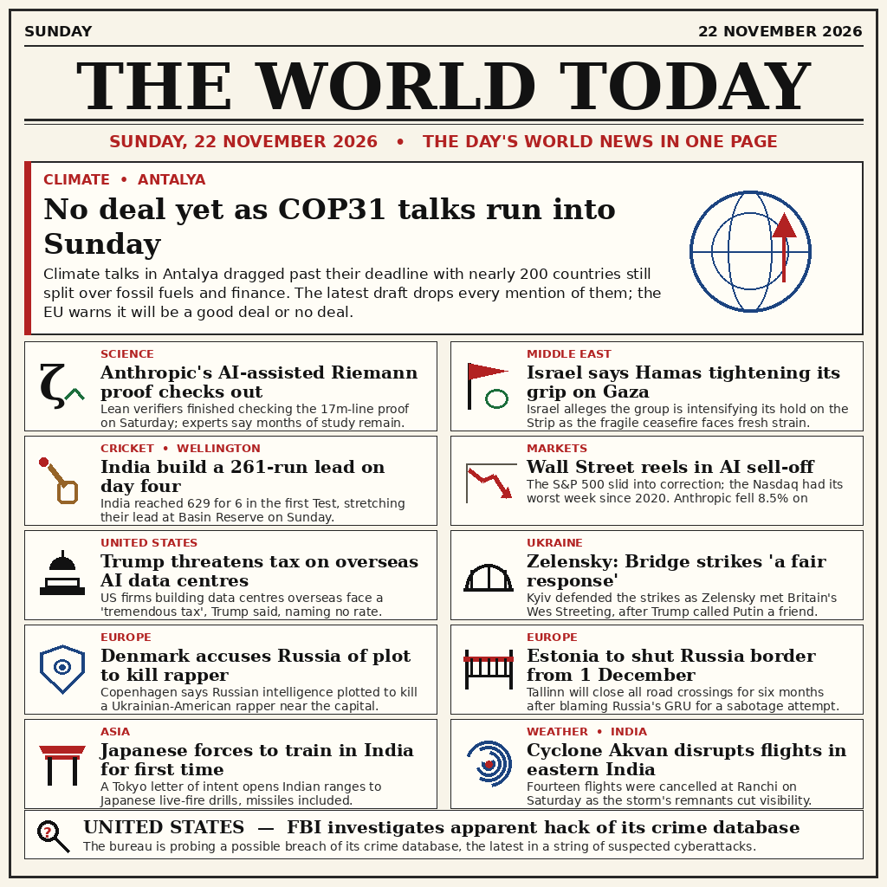

# THE WORLD TODAY — Sunday, 22 November 2026

[](https://make.fun/c/news-image-20261122)
[](LICENSE)

A one-page newspaper front page summing up the world news of
**Sunday, 22 November 2026**, drawn from scratch with Pillow.

Entry for the make.fun competition
[news-image-20261122](https://make.fun/c/news-image-20261122)
— *Sum up 22 November's world news in one image*.



## The day's stories

| # | Story |
|---|-------|
| 1 | **No deal yet as COP31 talks run into Sunday** — climate talks in Antalya drag past their deadline, split over fossil fuels and finance |
| 2 | **Anthropic's AI-assisted Riemann proof checks out** — Lean verifiers finish checking the 17m-line proof |
| 3 | **Israel says Hamas tightening its grip on Gaza** |
| 4 | **India build a 261-run lead on day four** — Wellington Test vs New Zealand |
| 5 | **Wall Street reels in AI sell-off** — S&P 500 in correction, Nasdaq's worst week since 2020 |
| 6 | **Trump threatens tax on overseas AI data centres** |
| 7 | **Zelensky: Bridge strikes 'a fair response'** |
| 8 | **Denmark accuses Russia of plot to kill rapper** |
| 9 | **Estonia to shut Russia border from 1 December** |
| 10 | **Japanese forces to train in India for first time** |
| 11 | **Cyclone Akvan disrupts flights in eastern India** |
| 12 | **FBI investigates apparent hack of its crime database** |

Stories were researched from news reports published on 22 November 2026
(and, for the weekend's continuing stories, from the latest reports
available that morning). Nothing is invented: where a story broke on an
earlier day of the weekend, the image dates it inside the text
("on Saturday", "on Friday").

## How it works

- `draw_poster.py` — draws `entry.png` (1024×1024, under 1 MiB) with Pillow:
  a masthead, the date, a lead story and eleven more, each with a short
  headline, a one-to-two-line summary and a simple code-drawn illustration.
  No photos, no network, no timestamps, no randomness — the same bytes
  every run.
- `main.py` — the entry point: copies `entry.png` to
  `$MAKEFUN_OUTPUT_DIR` (default `out`), standard library only.

## Run it

```sh
python3 draw_poster.py        # regenerate entry.png
MAKEFUN_OUTPUT_DIR=out python3 main.py   # write out/entry.png
```

## Determinism

Running `draw_poster.py` twice produces byte-identical `entry.png`
(verified by md5), and `main.py` run twice writes identical bytes.

## License

MIT — see [LICENSE](LICENSE).
